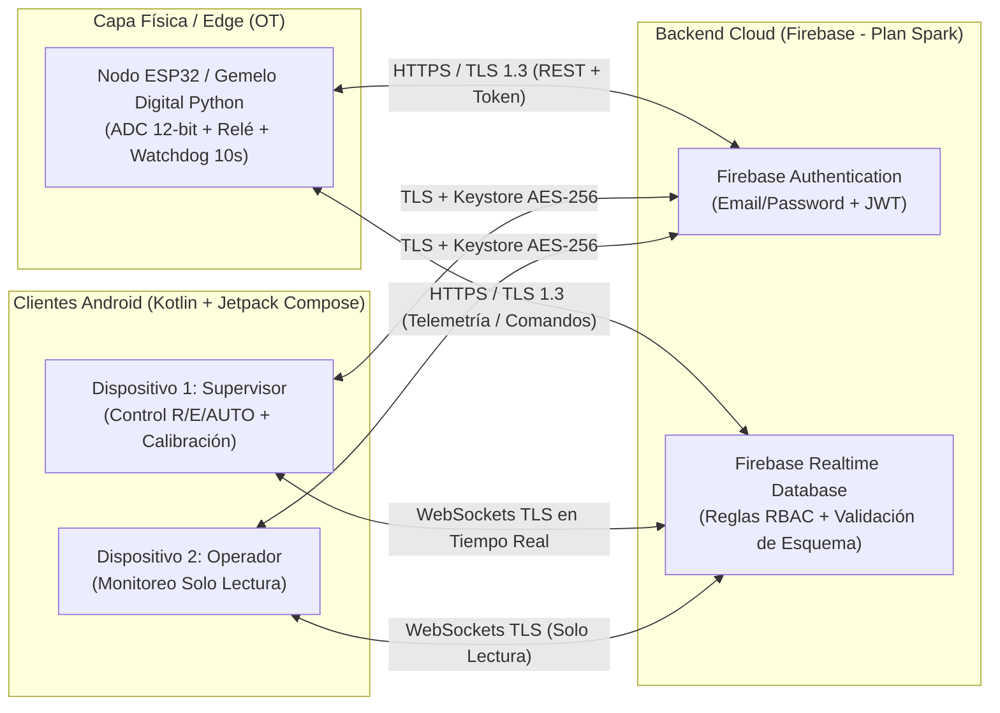
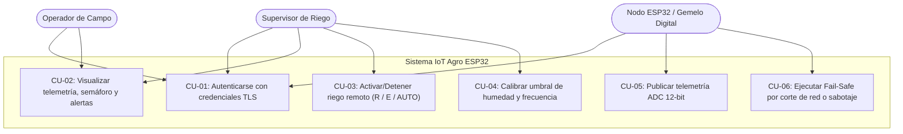
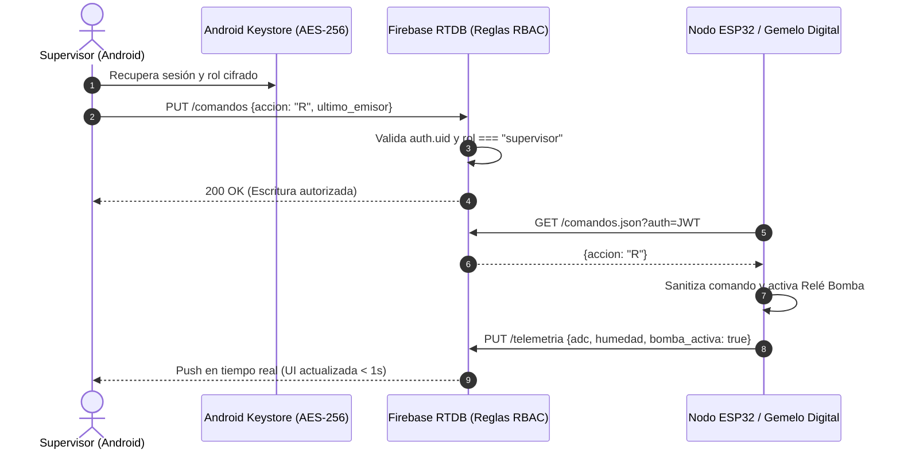

# Arquitectura del Sistema y Modelado UML

## 1. Justificación de Migración Tecnológica (Arduino + HC-05 a ESP32 + TLS)
La arquitectura inicial basada en Arduino UNO y Bluetooth HC-05 presentaba tres limitaciones críticas para un entorno de agricultura de precisión distribuido:
1. **Alcance físico restringido:** Bluetooth clásico limita la operación a ~10 metros sin obstáculos, impidiendo la supervisión remota multi-dispositivo.
2. **Ausencia de control de acceso granular (RBAC):** El enlace serial SPP no diferencia perfiles de operador y supervisor.
3. **Vulnerabilidad en tránsito:** Las tramas Bluetooth sin cifrado de capa de aplicación quedan expuestas a interceptación e inyección de comandos.

La migración hacia **ESP32 + Firebase Realtime Database + Android (Kotlin/Compose)** resuelve estas brechas mediante transporte cifrado **HTTPS/TLS 1.3**, autenticación basada en tokens JWT y validación de esquema en servidor.

---

## 2. Diagrama de Arquitectura y Componentes

---

## 3. Diagrama de Casos de Uso por Rol (RBAC)

---

## 4. Diagrama de Secuencia: Control Remoto y Respuesta OT

